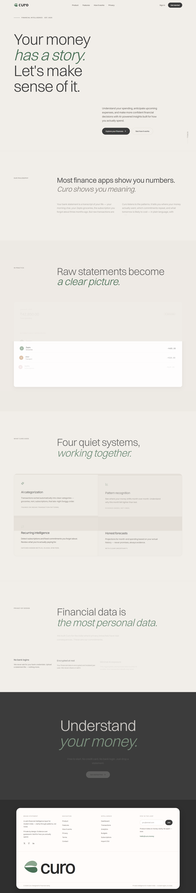
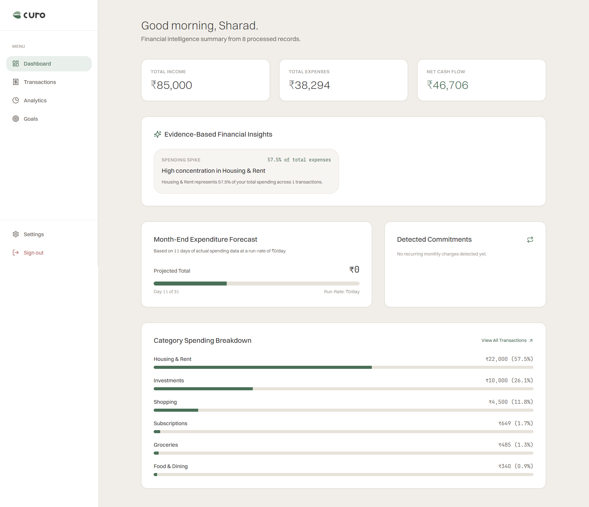
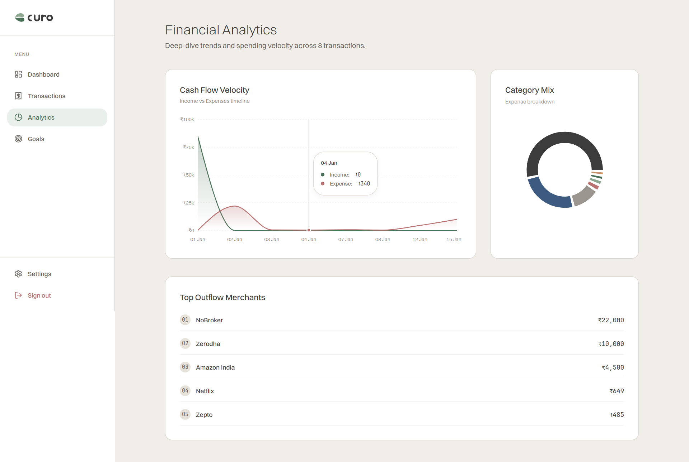

<div align="center">

  

  <h1>Curo — Your money, understood.</h1>

  <p><strong>Financial clarity, without the noise.</strong></p>

  <p>
    Turn messy Indian bank and UPI statements into a clearer picture of your spending.
    Import a CSV, make sense of transactions, and discover patterns with explainable insights.
  </p>

  <p><em>Built for modern India. Designed to feel a little more human.</em></p>

  <p>
    <a href="#-the-idea">The idea</a> ·
    <a href="#-features">Features</a> ·
    <a href="#-architecture">Architecture</a> ·
    <a href="#-get-started">Get started</a> ·
    <a href="#-security--privacy">Privacy</a>
  </p>

  <p>
    
    
    
    
    
    
    
  </p>

</div>

---

## ✳ The idea

Money data can be overwhelming. Bank statements are full of cryptic narrations, transactions are scattered across categories, and totals alone rarely explain the _why_ behind your spending.

**Curo is a personal-finance project built around a simple idea: your money should make more sense.**

Import a statement instead of handing over bank credentials. Curo normalizes transaction descriptions, categorizes activity, and presents insights based on the records you provide.

For example:

`UPI-SWIGGY-REST-PAY-BANGALORE-9912` → **Swiggy · Food & Dining**

No bank-password collection. No ad-driven financial product pitches. Just a calmer way to understand your spending.

## ✨ Features

- **Transaction categorization** — a Python service uses TF-IDF and Logistic Regression to classify transaction descriptions.
- **Readable merchant names** — normalize cryptic Indian UPI and card narrations.
- **Spending insights** — expenditure summaries and month-end projections based on transaction history.
- **Recurring payment detection** — surface patterns that may indicate subscriptions or regular bills.
- **Precision-first money math** — Decimal.js avoids common floating-point errors in financial calculations.
- **Privacy-minded imports** — upload CSV statements; the app is designed not to collect bank credentials.
- **Data controls** — user-scoped records, JSON export and account-data deletion flows.
- **A considered interface** — warm ivory surfaces, restrained green accents, Switzer typography and JetBrains Mono for financial figures.
- **Fallback categorization** — rule-based categorization is available when the ML service is unavailable.

> Curo's insights are derived from imported records. Forecasts and categories are estimates, not financial advice. Review results before relying on them.

## 🖥 Preview

|                     Landing page                      |                      Dashboard                       |                      Analytics                       |
| :---------------------------------------------------: | :--------------------------------------------------: | :--------------------------------------------------: |
|  |  |  |

## 🧭 How it works

1. **Import** a supported bank or UPI statement in CSV format.
2. **Normalize** transaction narrations into more readable merchant descriptions.
3. **Categorize** transactions using the ML service, with a deterministic fallback.
4. **Explore** summaries and patterns based on the imported data.

## 🏗 Architecture

```text
                         ┌──────────────────────┐
                         │    User's browser    │
                         └──────────┬───────────┘
                                    │ HTTPS
                         ┌──────────▼───────────┐
                         │      Next.js 15      │
                         │ UI · Auth · API      │
                         └───────┬───────┬──────┘
                                 │       │ HTTP
                        ┌────────▼───┐ ┌─▼────────────────┐
                        │   Prisma   │ │ Python FastAPI   │
                        │            │ │ scikit-learn     │
                        └─────┬──────┘ └──────────────────┘
                              │
                        ┌─────▼──────┐
                        │ Neon       │
                        │ PostgreSQL │
                        └────────────┘
```

## 🧰 Tech stack

| Area                | Tools                                        |
| ------------------- | -------------------------------------------- |
| Frontend            | Next.js 15.1, React 19, TypeScript 5.7       |
| Styling & motion    | Tailwind CSS 4, Framer Motion 12             |
| UI & visualization  | Radix UI, Lucide React, Recharts             |
| Forms & validation  | React Hook Form, Zod                         |
| Authentication      | Auth.js v5 with GitHub OAuth                 |
| Database            | Neon PostgreSQL, Prisma 6.2                  |
| Financial utilities | Decimal.js, PapaParse                        |
| ML service          | Python 3.12, FastAPI, scikit-learn, Pydantic |
| Testing & tooling   | Vitest, ESLint, pnpm                         |

## 🚀 Get started

### Prerequisites

- Node.js `20.11+`
- pnpm `9.x`
- Python `3.12+`
- A PostgreSQL database (the project is configured for Neon)
- A GitHub OAuth application

### 1. Clone the repository

Replace `YOUR_USERNAME` with your GitHub username.

```bash
git clone https://github.com/YOUR_USERNAME/curo.git
cd curo
pnpm install
```

### 2. Configure environment variables

```bash
cp .env.example .env
```

Add the values required by your local configuration:

```dotenv
DATABASE_URL="your-neon-postgresql-connection-string"
AUTH_SECRET="your-auth-secret"
AUTH_GITHUB_ID="your-github-oauth-client-id"
AUTH_GITHUB_SECRET="your-github-oauth-client-secret"
```

Generate an Auth.js secret with:

```bash
pnpm exec auth secret
```

Set your GitHub OAuth callback URL to:

```text
http://localhost:3000/api/auth/callback/github
```

**Never commit your `.env` file or real credentials.**

### 3. Set up the database

```bash
pnpm exec prisma generate
pnpm exec prisma db push
```

Use your team's migration workflow instead of `db push` for production deployments.

### 4. Install the ML service dependencies

```bash
cd ml-service
python -m pip install --upgrade pip
pip install -r requirements.txt --prefer-binary
cd ..
```

### 5. Run the app

Start the Next.js app in one terminal:

```bash
pnpm dev
```

Start the ML service in another terminal:

```bash
cd ml-service
python main.py
```

- Web app: `http://localhost:3000`
- ML service: `http://127.0.0.1:8000`
- API docs: `http://127.0.0.1:8000/docs`

### 6. Try the import flow

1. Open the web app.
2. Sign in with GitHub.
3. Open **Transactions** and choose the CSV import option.
4. Use `docs/sample-statement.csv` if the sample file is present in your checkout.
5. Review the categorized transactions and dashboard summaries.

## 🧪 Tests

Run the test suite:

```bash
pnpm test
```

Run tests once in CI mode:

```bash
pnpm test --run
```

The original project notes list coverage for:

- Merchant normalization for Indian UPI patterns
- SHA-256 deduplication hashing
- Decimal arithmetic
- Baseline categorization
- Financial overview calculations

Run the checks configured in the repository before opening a pull request. Actual test coverage may change as the project evolves.

## 🗂 Project structure

```text
curo/
├── app/
│   ├── (marketing)/       # Public pages
│   ├── (auth)/            # Authentication pages
│   ├── (app)/             # Dashboard and finance pages
│   ├── actions/           # Server Actions
│   ├── api/               # API routes
│   ├── error.tsx          # Global error boundary
│   ├── not-found.tsx      # 404 page
│   ├── robots.ts           # SEO directives
│   └── sitemap.ts          # Sitemap
├── components/
│   ├── brand/             # Logo system
│   ├── marketing/         # Landing page components
│   ├── app/               # App navigation and interactions
│   ├── charts/            # Chart wrappers
│   ├── motion/            # Animation primitives
│   └── ui/                # Reusable UI components
├── lib/
│   ├── auth/              # Auth helpers
│   ├── db/                # Prisma client
│   ├── finance/            # Categorization and insights
│   ├── ml/                # ML service client
│   └── utils/             # Shared utilities
├── ml-service/            # Python FastAPI service
├── prisma/                # Database schema
├── public/
│   ├── fonts/             # Local fonts
│   ├── logos/             # Brand assets
│   └── favicon.svg
├── tests/                 # Automated tests
├── types/                 # TypeScript declarations
├── auth.ts
├── auth.config.ts
├── middleware.ts
└── vitest.config.mjs
```

## 🎨 Design direction

Curo aims for a quiet, editorial visual language: less spreadsheet, more clarity.

| Token      | Value     | Use                                 |
| ---------- | --------- | ----------------------------------- |
| Primary    | `#4A7057` | Primary actions and positive states |
| Secondary  | `#8CA68F` | Highlights and supporting accents   |
| Background | `#F1EEE9` | Warm ivory canvas                   |
| Surface    | `#FFFFFF` | Cards and panels                    |
| Text       | `#3C3C3C` | Main text                           |
| Warning    | `#C4956A` | Warnings                            |
| Negative   | `#B87070` | Errors and negative states          |

- **Display & body:** Switzer
- **Monospace:** JetBrains Mono, particularly for tabular financial figures

## 🔐 Security & privacy

Curo is designed with privacy-conscious defaults and with India's Digital Personal Data Protection Act, 2023, in mind. This statement describes project intent; it is not a legal certification or guarantee of compliance.

- **No bank credentials:** the documented workflow uses CSV imports.
- **User-scoped records:** database access should be scoped to the authenticated user.
- **Duplicate detection:** SHA-256 hashes help identify repeated imports.
- **Data portability:** a JSON export flow is documented in the application.
- **Deletion controls:** account-data deletion is intended to remove associated records.
- **Session security:** the project notes describe HTTP-only, `SameSite=Lax` cookies.
- **Minimized ML input:** the classifier is intended to receive merchant strings rather than full personal transaction records.

Before using real financial data, review authorization boundaries, logs, retention behavior, backups, third-party processing and the actual deletion implementation. Do not upload real statements to an untrusted deployment.

## 🧠 Machine learning

The ML microservice uses a scikit-learn pipeline combining TF-IDF text features and Logistic Regression.

```python
Pipeline([
    (
        "tfidf",
        TfidfVectorizer(
            ngram_range=(1, 3),
            lowercase=True,
            max_features=1000,
        ),
    ),
    (
        "clf",
        LogisticRegression(
            C=10.0,
            max_iter=200,
            solver="lbfgs",
        ),
    ),
])
```

The original project notes describe training patterns across ten categories:

- Food & Dining
- Groceries
- Transport
- Housing
- Utilities
- Subscriptions
- Shopping
- Healthcare
- Investments
- Income

Predictions can be wrong, especially for unfamiliar merchant names. The rule-based fallback is intended to keep basic categorization available when the ML service is offline.

## 🛣 Roadmap

Potential next steps for a more dependable release:

- [ ] Add and maintain real product screenshots
- [ ] Expand automated tests for imports, authorization and financial edge cases
- [ ] Verify database backup and restore procedures
- [ ] Add production monitoring and actionable error reporting
- [ ] Test responsive layouts and keyboard accessibility
- [ ] Document supported CSV formats and import limitations

## 🤝 Contributing

Curo is a portfolio project, and thoughtful feedback is welcome.

1. Open an issue describing the bug or proposal.
2. Keep pull requests focused and explain the reason for the change.
3. Include tests for behavior changes where practical.
4. Never include real financial statements, secrets or personal data in issues, fixtures or screenshots.

## 📄 License

Released under the MIT License. See [`LICENSE`](LICENSE) for details.

## 🙏 Credits

- **Design inspiration:** [Noho](https://noho.ink/)
- **Typography:** Switzer by Indian Type Foundry
- **Database:** [Neon](https://neon.tech/)
- **Icons:** [Lucide](https://lucide.dev/)

---

<div align="center">

<strong>Built with intention for modern India.</strong>

  <br />

<sub>Less noise. More understanding.</sub>

<br /><br />

If Curo sparks an idea or helps you learn something, consider giving the repository a ⭐

</div>
